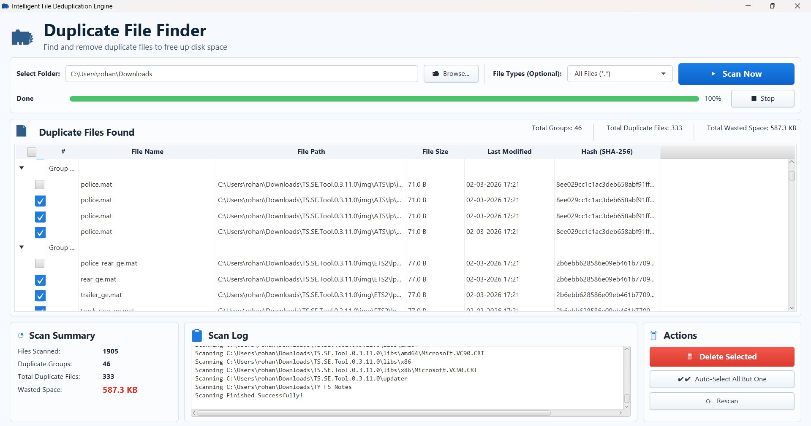

# Intelligent File Deduplication Engine (IFDE)

A high-performance desktop application built with **Java 21 and JavaFX** to find and eliminate duplicate files with mathematical certainty. It identifies duplicates by computing cryptographic **SHA-256 hashes** via memory-safe Java NIO streams, groups matching files, calculates recoverable storage space, and allows safe permanent deletion from an interactive graphical dashboard.



> **Important:** Deleting files is permanent. Review the displayed paths and selected files carefully before confirming deletion.

---

## Features

- **Recursive directory scanning** — scans a selected folder and its subdirectories.
- **Cryptographic content hashing** — computes SHA-256 digests for each readable file; files with matching hashes are grouped as duplicates regardless of filename.
- **Optional file-type filters** — scan all files or filter by categories such as images, videos, audio, documents, spreadsheets, archives, executables, and source code.
- **Real-time progress & scan log** — displays live scan progress, percentage complete, current directory activity, and skipped unreadable nodes.
- **Duplicate summary cards** — shows duplicate groups, total duplicate files, files scanned, and estimated reclaimable wasted space.
- **Detailed file metadata** — displays file name, full path, formatted size, last-modified timestamp, and SHA-256 hash.
- **Selection controls** — select individual files, select all files, or automatically select all but one file in each duplicate group (preserving the primary copy).
- **Safe batch deletion** — permanently delete selected files after user confirmation, reporting any locked or unreadable files without crashing.
- **Non-blocking multithreaded UI** — dedicated background worker thread ensures the JavaFX dashboard remains responsive at 60 FPS during heavy disk I/O.

---

## How Duplicate Detection Works

1. **Pass 1 (File Counting):** Quickly traverses the target folder to count eligible files, establishing an accurate denominator for 0–100% progress tracking.
2. **Pass 2 (Chunked Hashing):** Streams file content through a 64 KB Direct `ByteBuffer` via Java NIO `FileChannel` into `MessageDigest` (SHA-256). Memory usage stays under 100 MB RAM even when hashing multi-gigabyte ISOs or videos.
3. **Duplicate Grouping:** Indexes files into a hash-bucketed data store (`HashMap<String, ArrayList<FileRecord>>`). Groups containing $\ge 2$ files are flagged as duplicates.

---

##  How to Run

### Option 1: Run Pre-built Executable JAR (Easiest)
Requires only a standard **Java 21+ Runtime (JRE/JDK)** — no Maven or JavaFX installation needed:
```bash
# Run the pre-built release JAR
java -jar release/ifde.jar
```

### Option 2: Run with Maven (Recommended for Development)
Maven automatically downloads OpenJFX dependencies and compiles the source:
```bash
# Run the application directly
mvn javafx:run

# Or package into a standalone executable Fat JAR
mvn clean package
```

---

## Project Structure

```text
Intelligent-File-Deduplication-Engine/
├── docs/
│   ├── IFDE_Project_Report_Final.pdf   # Academic project report
│   └── preview.png                     # Application preview screenshot
├── release/
│   └── ifde.jar                        # Standalone executable Fat JAR
├── src/
│   └── com/
│       └── ifde/
│           ├── controller/
│           │   ├── Launcher.java          # Fat JAR bootstrap launcher
│           │   ├── MainApplication.java   # JavaFX Application entry point
│           │   └── MainViewController.java# UI event handler & thread bridge
│           ├── model/
│           │   ├── DateFormatterHelper.java
│           │   ├── DuplicateDataStore.java# Duplicate collection & space math
│           │   ├── EngineCore.java        # Two-pass recursive scanner
│           │   ├── FileRecord.java        # File metadata DTO
│           │   ├── HashGenerator.java     # Chunked NIO SHA-256 engine
│           │   └── ScanListener.java      # Callback interface for UI decoupling
│           └── view/
│               ├── Application.css        # Stylesheet
│               ├── MainView.fxml          # Declarative layout
│               └── icon.png               # Window branding icon
├── pom.xml                                # Maven build & shade configuration
└── README.md
```

---

## Safety and Limitations

- **Deletion is permanent:** Deleted files are removed directly via filesystem calls.
- **Review automatic selection:** "Auto-Select" marks all redundant copies while keeping the first file in each group intact. Always review before confirming deletion.
- **Locked & protected files:** Files with restricted permissions are logged and skipped without halting traversal.
- **Symbolic links:** Symlink nodes are automatically skipped to prevent infinite recursion.
- **Storage scope:** Traversal operates across local and mounted block storage.

---

## Future Improvements

- **Persistent Hash Caching (SQLite):** Persist computed SHA-256 digests in an embedded SQLite database indexed by file path and last-modified timestamp, reducing subsequent scans of multi-terabyte drives from minutes to seconds.
- **Parallel Multi-Threaded Hashing:** Implement Java `ForkJoinPool` or parallel worker streams to hash independent files concurrently across multi-core CPUs on high-speed NVMe SSD storage.
- **System Trash / Recycle Bin Integration:** Move files to the native OS Trash/Recycle Bin (via Desktop API or OS-specific commands) instead of permanent deletion, providing a safety net against accidental removal.
- **Advanced Filtering & Exclusion Rules:** Support custom glob/regex exclusion patterns (e.g., ignoring `.git`, `node_modules`, or system directories) and configurable minimum/maximum file size thresholds.
- **Cloud & Network Storage Connectors:** Extend filesystem traversal to cloud storage APIs (Google Drive, Nextcloud, Dropbox) to detect remote duplicate backups.

---